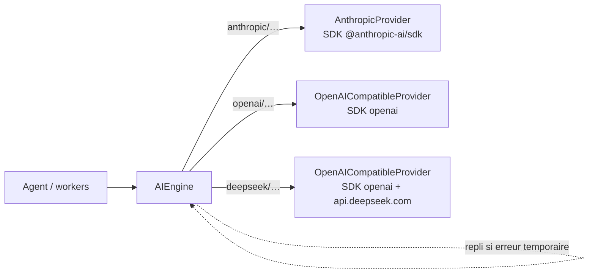

# Moteur d'IA multi-fournisseurs (`@primeo/ai-engine`)

## Objectif

Appeler OpenAI, Anthropic (Claude), DeepSeek — ou tout autre fournisseur — par **une seule
interface**, sans que le reste de l'application sache quel fournisseur répond. Un agent désigne
son modèle par une référence **`fournisseur/modèle`** stockée en configuration
(ex. `anthropic/claude-opus-5-5`) : changer de modèle ne demande aucune modification de code.



## Contrat commun (`types.ts`)

| Élément           | Rôle                                                                                                                                                                                                                               |
| ----------------- | ---------------------------------------------------------------------------------------------------------------------------------------------------------------------------------------------------------------------------------- |
| `GenerateRequest` | `model`, `system`, `messages`, `tools`, `maxOutputTokens` (défaut 16 000), `reasoningEffort` (`low`/`medium`/`high`), `temperature`                                                                                                |
| `ChatMessage`     | `user`, `assistant` (texte + appels d'outils), `tool` (résultat d'un outil)                                                                                                                                                        |
| `GenerateResult`  | `text`, `toolCalls`, `finishReason` (`stop`, `length`, `tool_calls`, `refusal`, `content_filter`, `other`), `usage` (jetons d'entrée, de sortie, en cache), `latencyMs`, `message` à ajouter à l'historique, `refusal`, `warnings` |
| `AIProviderError` | Erreur normalisée : `kind` (`authentication`, `rate_limit`, `overloaded`, `server`, `timeout`, `network`, `invalid_request`…) et `retryable`                                                                                       |

**État propre au fournisseur** : certains modèles renvoient des éléments qui doivent être
retransmis tels quels au tour suivant (les blocs de réflexion de Claude). Ils voyagent dans
`message.providerState` et ne sont réutilisés **que** par le même fournisseur et le même modèle ;
une conversation peut donc changer de fournisseur en cours de route.

## Fournisseurs

| Fournisseur | Implémentation                                                      | Particularités gérées                                                                                                                                                                                                                                                                                                                                                                                         |
| ----------- | ------------------------------------------------------------------- | ------------------------------------------------------------------------------------------------------------------------------------------------------------------------------------------------------------------------------------------------------------------------------------------------------------------------------------------------------------------------------------------------------------- |
| Anthropic   | `AnthropicProvider`, SDK officiel                                   | Modèle par défaut `claude-opus-5-5` ; `reasoningEffort` → `output_config.effort` ; `temperature` non envoyée (refusée par les modèles actuels, avertissement renvoyé) ; résultats d'outils parallèles regroupés dans un seul message ; **repli serveur en cas de refus** (`fallbacks: "default"`) sur les modèles qui le prennent en charge, signalé par `servedByFallbackModel` ; catégorie de refus exposée |
| OpenAI      | `createOpenAIProvider`, SDK officiel                                | `max_completion_tokens`, `reasoning_effort`, refus via `message.refusal`, jetons en cache                                                                                                                                                                                                                                                                                                                     |
| DeepSeek    | `createDeepSeekProvider`, SDK `openai` + `https://api.deepseek.com` | `max_tokens` ; `reasoning_effort` non pris en charge (avertissement) ; jetons en cache `prompt_cache_hit_tokens` ; le raisonnement interne n'est jamais réinjecté                                                                                                                                                                                                                                             |

Les SDK gèrent eux-mêmes les nouvelles tentatives (2 par défaut) sur 429, 5xx et erreurs réseau.

## Routeur (`AIEngine`)

```ts
import { createAIEngineFromEnvironment } from "@primeo/ai-engine";
import { loadEnvironment } from "@primeo/security/secrets";

const engine = createAIEngineFromEnvironment(loadEnvironment("workers"));
const result = await engine.generate({
  model: "anthropic/claude-opus-5-5",
  fallbacks: ["openai/<modèle>", "deepseek/deepseek-chat"],
  system: "Tu es le directeur financier de Primeo.",
  messages: [{ role: "user", content: "Prépare la synthèse de trésorerie." }],
  reasoningEffort: "high",
});
```

- Seuls les fournisseurs dont la clé est configurée sont enregistrés.
- En cas d'erreur **temporaire** (surcharge, limite de débit, panne, délai), le modèle suivant de
  `fallbacks` est essayé. Une erreur définitive (clé refusée, requête invalide) arrête la chaîne.
- `result.attempts` trace chaque tentative ; `engine.onUsage(...)` reçoit chaque appel réussi
  (prévu pour alimenter la table `ai_usage` et le contrôle des budgets).

## Ajouter un fournisseur

1. **API compatible OpenAI** (Mistral, Groq…) : une fabrique de quelques lignes sur le modèle de
   `providers/deepseek/deepseek-provider.ts` (`baseURL`, nom du paramètre de jetons, prise en
   charge de `reasoning_effort`).
2. **Autre API** : une classe implémentant `AIProvider` (`id` + `generate()`), qui traduit le
   contrat commun et normalise erreurs et usage.
3. L'enregistrer dans `model-router/from-environment.ts`, déclarer sa clé dans le catalogue des
   variables (`packages/security/secrets/catalog.ts`) et `.env.example`, et l'ajouter au type
   `ai_model_provider` par migration.

## Tests

`tests/unit/ai-engine/` vérifie, avec un `fetch` simulé (aucun appel réseau), la requête exacte
envoyée à chaque fournisseur et la normalisation de leurs réponses et erreurs, ainsi que le
routage et les replis. **Aucun appel réel n'a encore été fait** : aucune clé n'est configurée.
Un premier appel réel par fournisseur sera fait dès que les clés seront fournies.
