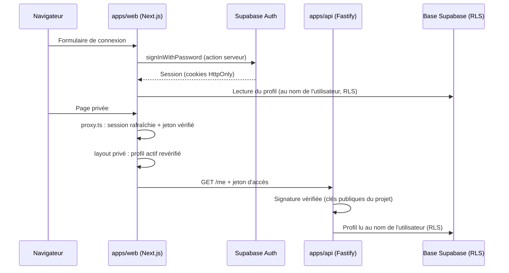

# Authentification et accès aux données

## Vue d'ensemble



| Couche          | Rôle                                                                                                                    | Fichier                                                   |
| --------------- | ----------------------------------------------------------------------------------------------------------------------- | --------------------------------------------------------- |
| Base de données | Inscription **sur invitation uniquement** ; profil créé automatiquement avec le rôle de l'invitation                    | `database/migrations/20261127001200_user_invitations.sql` |
| Proxy Next.js   | Rafraîchit la session et redirige les visiteurs non connectés vers `/login?next=…`                                      | `apps/web/src/proxy.ts`                                   |
| Layout privé    | Revérifie, côté serveur, le jeton **et** l'existence d'un profil actif                                                  | `apps/web/src/app/(command-center)/layout.tsx`            |
| API             | Garde `requireAuthenticatedUser` : jeton vérifié localement (ES256, émetteur, audience, expiration), profil actif exigé | `apps/api/src/guards/authenticate.ts`                     |

## Parcours

| Parcours            | Pages / routes                                                     | Détails                                                                                                          |
| ------------------- | ------------------------------------------------------------------ | ---------------------------------------------------------------------------------------------------------------- |
| Inscription         | `/signup` → e-mail → `/auth/callback`                              | Refusée par la base sans invitation valide. Mot de passe : 12 caractères minimum, majuscule, minuscule, chiffre. |
| Connexion           | `/login`                                                           | Refusée si le profil applicatif est absent ou désactivé. Redirection vers `next` (chemins internes uniquement).  |
| Mot de passe oublié | `/forgot-password` → e-mail → `/auth/callback` → `/reset-password` | Réponse identique que le compte existe ou non.                                                                   |
| Déconnexion         | bouton dans l'en-tête                                              | Action serveur `signOutAction`.                                                                                  |
| Compte non autorisé | `/auth/denied`                                                     | Ferme la session puis affiche un message sur `/login`.                                                           |

## Clients Supabase

| Client                        | Où                                             | Clé                                | RLS        |
| ----------------------------- | ---------------------------------------------- | ---------------------------------- | ---------- |
| `createSupabaseBrowserClient` | `apps/web/src/services/supabase/browser.ts`    | publiable                          | appliquée  |
| `createSupabaseServerClient`  | `apps/web/src/services/supabase/server.ts`     | publiable + session                | appliquée  |
| `createUserClient`            | `@primeo/integrations/supabase` (API)          | publiable + jeton de l'utilisateur | appliquée  |
| `createServiceClient`         | `@primeo/integrations/supabase` (API, workers) | **secrète**                        | contournée |

Règle : toutes les **écritures** métier passent par l'API. Les rôles exposés au navigateur ne
peuvent rien écrire en base (voir `docs/database-schema.md`, section 14).

## Inviter un utilisateur

Tant que l'écran d'administration n'existe pas, une invitation se crée en SQL (éditeur SQL de
Supabase), puis la personne crée son compte sur `/signup` avec cette adresse :

```sql
insert into public.user_invitations (email, role)
values ('adresse@exemple.com', 'executive');  -- executive | administrator | observer
```

L'invitation expire après 14 jours et ne peut servir qu'une fois.

## Configuration Supabase (tableau de bord)

| Réglage                                            | Valeur                                                                                                                                                       |
| -------------------------------------------------- | ------------------------------------------------------------------------------------------------------------------------------------------------------------ |
| Authentication → URL Configuration → Site URL      | URL publique de l'interface (`http://localhost:3000` en local)                                                                                               |
| Authentication → URL Configuration → Redirect URLs | `<URL publique>/auth/callback`                                                                                                                               |
| Authentication → Emails → SMTP                     | Un SMTP personnalisé est nécessaire en production : le service d'envoi intégré de Supabase n'envoie qu'aux membres de l'organisation et est fortement limité |

## Points prévus ensuite

- **Double authentification (TOTP)** : la colonne `users.mfa_required` et l'information `mfa`
  renvoyée par `GET /me` sont en place ; l'enrôlement et l'exigence du niveau `aal2` restent à
  implémenter.
- Écran d'administration des invitations.
